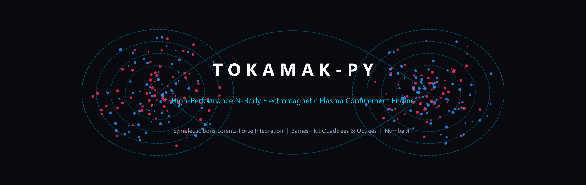
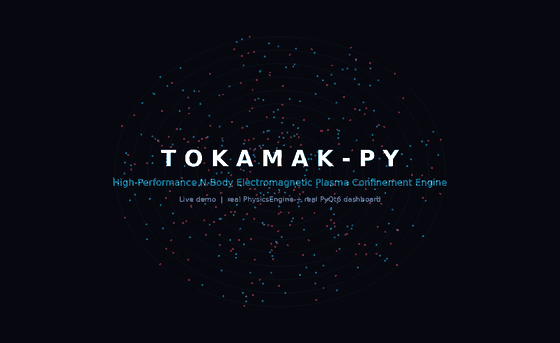
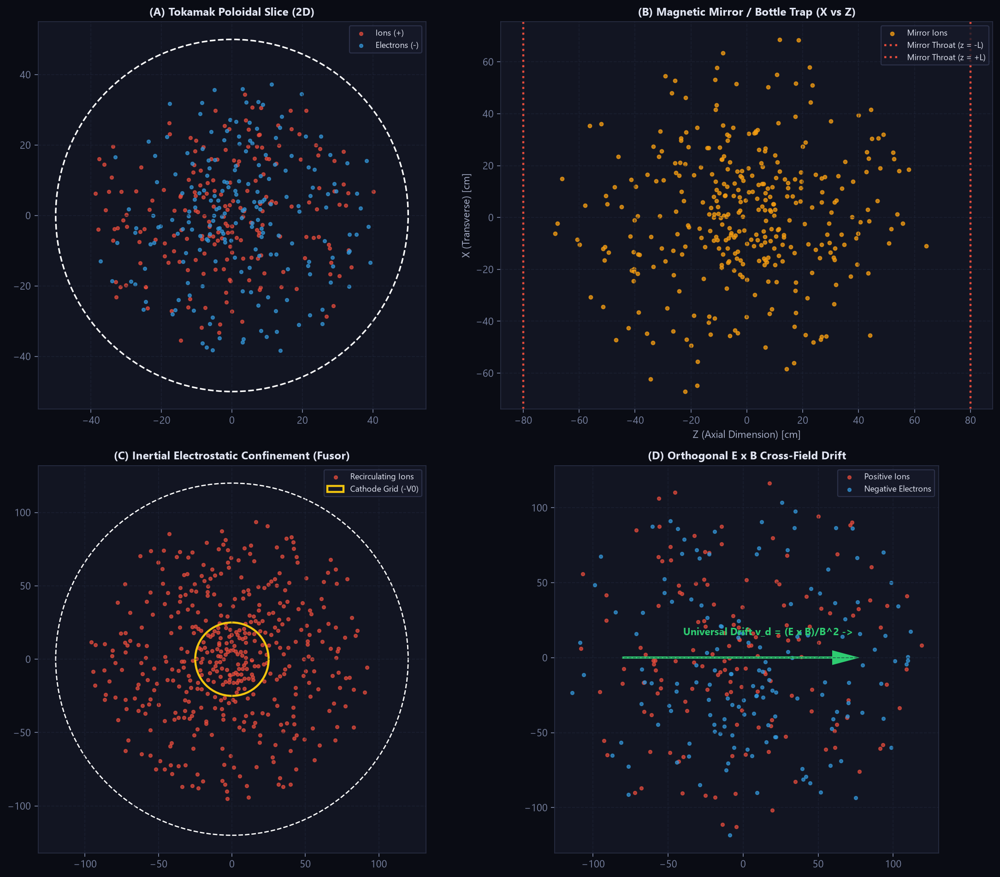
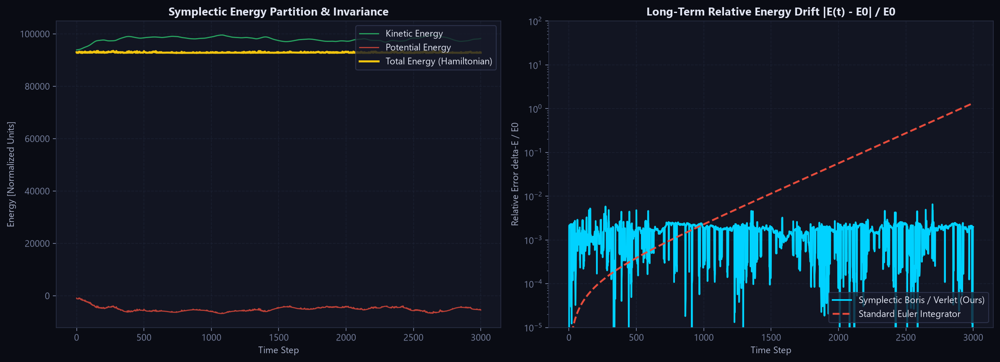
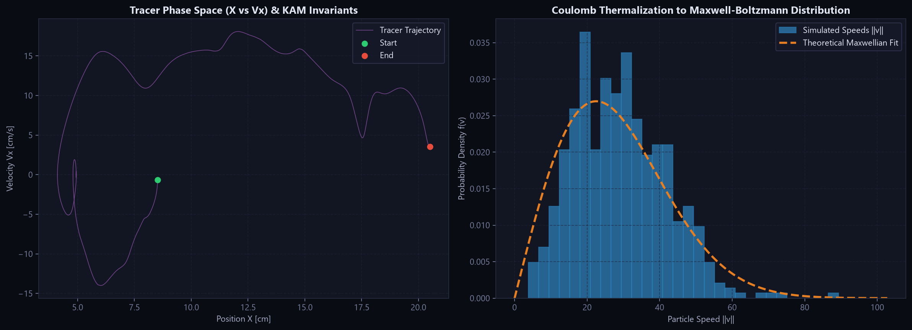
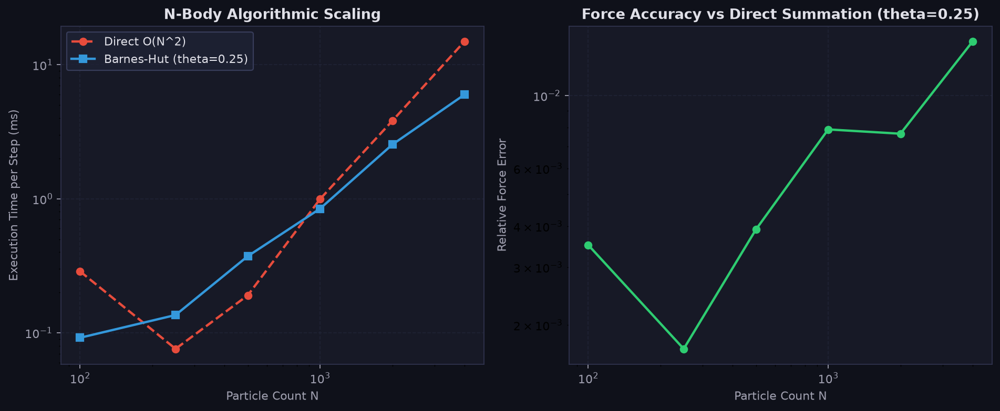

<div align="center">



# Tokamak-Py

**A high-performance N-body electromagnetic plasma confinement engine.**
Symplectic Boris integration · Barnes-Hut quadtrees & octrees · Numba JIT · real-time PyQt6 dashboard.

[](https://github.com/rajveersinh-is-dev/Tokamak-Py/actions/workflows/ci.yml)
[](LICENSE)
[](https://www.python.org/downloads/)
[](#testing)
[](https://rajveersinh-is-dev.github.io/Tokamak-Py/)

**[▶ Open the live simulation](https://rajveersinh-is-dev.github.io/Tokamak-Py/)** — a real-time browser port of the engine. No install required.



*The actual PyQt6 dashboard driving the real engine — [watch the full 20-second demo](assets/demo.mp4) (tokamak · magnetic mirror · fusor · E × B drift · classic sandbox).*

</div>

---

## Overview

Tokamak-Py simulates charged-particle plasmas as an N-body system: every particle feels the softened Coulomb force of every other, plus external electric and magnetic fields, and is advanced with a **symplectic Boris integrator** that conserves phase-space volume. It scales from a few hundred particles on a laptop to thousands with Barnes-Hut tree decomposition, and ships with a live desktop dashboard, a headless CLI, and a benchmark suite.

It is a physics and numerical-methods toolkit, not a full magnetohydrodynamics code — the model is kinetic (particle) rather than fluid, and the fields are prescribed rather than self-consistently evolved.

| | |
|---|---|
| **Integrator** | Symplectic Boris (2D-3V and 3D-3V) — exact magnetic rotation, second-order electric push |
| **Solvers** | Barnes-Hut quadtree (2D) / octree (3D) in `O(N log N)`, plus an exact `O(N²)` direct solver |
| **Fields** | Tokamak torus, 2D poloidal slice, magnetic mirror, IEC fusor, orthogonal E × B, zero-field |
| **Boundaries** | Circular, toroidal (first-wall limiter) and spherical reflective limiters |
| **Interface** | Interactive PyQt6/PyQtGraph dashboard + headless CLI + Python API |
| **Acceleration** | Numba `njit` with JIT caching and `prange` parallelism |

---

## Highlights

- **Symplectic by construction.** The Boris rotation preserves the magnetic part of the motion exactly, so total energy stays flat over thousands of steps instead of drifting like a forward-Euler scheme (relative drift ≈ 2 × 10⁻³ over 800 steps in the shipped benchmark).
- **Scales with particle count.** Barnes-Hut overtakes exact summation around N ≈ 1000 and holds a ~2.5–2.9× lead at larger N, with relative force error held below ~1.3 × 10⁻².
- **Real confinement physics.** Tokamak presets reproduce flux surfaces, gyro-orbits and trapped-particle **banana orbits** from the 1/R variation of the toroidal field; the mirror preset shows bottle reflection and loss cones; the E × B preset shows mass- and charge-independent drift.
- **Runs at interactive speed.** The 2D tokamak preset integrates 600 particles at **≈ 149 FPS** (6.7 ms/step) headless on CPU.
- **Live in the browser.** A faithful JavaScript port of the Boris step, field models and Coulomb solver powers the [live demo page](https://rajveersinh-is-dev.github.io/Tokamak-Py/).

---

## Quickstart

**Requirements:** Python 3.10+. The dashboard needs PyQt6/PyQtGraph; the CLI, Python API and tests run without a display.

```bash
git clone https://github.com/rajveersinh-is-dev/Tokamak-Py.git
cd Tokamak-Py
pip install -r requirements.txt
```

### Interactive dashboard

```bash
python main.py
```

Launches the real-time PyQt6 dashboard: a particle confinement sandbox with tracer orbits, live symplectic energy telemetry, a Maxwell-Boltzmann speed distribution, and controls for preset, particle count, B-field scale and time step.

### Headless CLI

```bash
# Run a preset and save a diagnostic figure
python main.py run --preset tokamak_2d --particles 600 --steps 800 --output fig.png

# List the available physical presets
python main.py presets

# Benchmark Barnes-Hut against direct O(N^2) summation
python main.py benchmark --theta 0.25 --save-chart bench.png
```

### Python API

```python
from tokamak_py import PhysicsEngine

engine = PhysicsEngine(preset="tokamak_2d", n_particles=600, solver="barnes_hut")

for _ in range(500):
    engine.step()

print("kinetic   :", engine.kinetic_energy)
print("potential :", engine.potential_energy)
print("rel. drift:", engine.get_relative_energy_drift())
print("temperature estimate:", engine.get_temperature())
```

---

## Presets

Each preset bundles a field configuration, geometry, species mix and numerical parameters.

| Preset | Dim | Field model | Boundary | Particles | kₑ | v_th |
|---|---|-------------|---|--:|--:|--:|
| `tokamak_2d` | 2D | Poloidal tokamak slice | Circular | 600 | 300 | 30 |
| `tokamak_3d` | 3D | Toroidal + poloidal torus | Toroidal | 500 | 200 | 25 |
| `magnetic_mirror` | 3D | Magnetic bottle trap | Spherical | 400 | 100 | 20 |
| `fusor` | 2D | IEC electrostatic well | Circular | 600 | 500 | 5 |
| `exb_drift` | 2D | Uniform E ⊥ B | Circular | 400 | 50 | 15 |
| `classic_2d` | 2D | Self-consistent (no external field) | Circular | 1000 | 1000 | 0 |

<div align="center">

</div>

---

## Physics

### Boris integrator

For each particle the Lorentz force `F = q(E + v × B)` is advanced with the standard Boris split: a half-step electric push, an exact rotation of the velocity about the local magnetic field, then a second half-step electric push. The rotation is a pure rotation in velocity space, so it conserves kinetic energy and phase-space volume exactly regardless of `dt` — the reason energy stays bounded over long runs. In 2D the out-of-plane velocity component still undergoes the full 3D rotation (2D-3V).

### Barnes-Hut tree decomposition

Forces are accumulated on a quadtree (2D) or octree (3D). A cell is treated as a single effective mass when the ratio of its size to the particle's distance falls below the opening angle θ; otherwise it is opened. This reduces the per-step cost from `O(N²)` to `O(N log N)` at the price of a small, controllable force error. A direct pairwise solver is included as ground truth and is selected automatically for small systems.

### Energy conservation

The engine tracks kinetic, potential and total Hamiltonian energy each step, and exposes `get_relative_energy_drift()`. The figures below compare the symplectic scheme against a non-symplectic Euler baseline, and show the Coulomb thermalisation of a tracer onto a Maxwell-Boltzmann distribution.

<div align="center">


</div>

---

## Performance

Measured with the built-in benchmark (`python main.py benchmark --theta 0.25`) on CPU:

| N particles | Direct `O(N²)` (ms) | Barnes-Hut (ms) | Speedup | Relative force error |
|--:|--:|--:|--:|--:|
| 100 | 0.44 | 0.66 | 0.66× | 2.4 × 10⁻³ |
| 250 | 1.47 | 1.24 | 1.18× | 1.9 × 10⁻³ |
| 500 | 1.81 | 2.31 | 0.78× | 4.1 × 10⁻³ |
| 1000 | 13.67 | 5.51 | **2.48×** | 4.5 × 10⁻³ |
| 2000 | 46.22 | 15.83 | **2.92×** | 1.7 × 10⁻² |
| 4000 | 133.52 | 53.01 | **2.52×** | 1.3 × 10⁻² |

<div align="center">

</div>

At small N the fixed cost of building and traversing the tree outweighs the asymptotic gain, so the direct solver wins — that is why `PhysicsEngine` falls back to direct summation below ~60 particles.

---

## Project structure

```
tokamak_py/
├── engine.py          # PhysicsEngine — fields + solver + integrator, with energy telemetry
├── fields.py          # Numba field kernels: tokamak 2D/3D, mirror, fusor, E×B, zero-field
├── integrators.py     # Symplectic Boris step (2D-3V, 3D-3V) + boundary limiters
├── quadtree.py        # Barnes-Hut tree for 2D
├── octree.py          # Barnes-Hut tree for 3D
├── direct.py          # Exact O(N^2) Coulomb force and potential energy
├── presets.py         # Named physical scenarios
├── constants.py       # SI constants and plasma species
├── gui.py             # PyQt6 dashboard
├── gui_controls.py    # Control toolbar
├── gui_telemetry.py   # pyqtgraph telemetry plots
└── cli.py             # Headless run / benchmark / presets subcommands
main.py                # Entrypoint: dashboard by default, CLI when flags are given
physics.py             # Backward-compatibility re-exports
scripts/generate_assets.py   # Regenerates the figures in assets/
```

---

## Testing

```bash
pytest tests/
```

25 tests cover the integrators, field models, force solvers, quadtree/octree construction, the engine and the CLI. CI runs them on Python 3.10, 3.11 and 3.12.

---

## Regenerating the figures

```bash
python scripts/generate_assets.py
```

Recomputes every scientific plot in `assets/` from the live engine.

---

## License

MIT — see [LICENSE](LICENSE).
